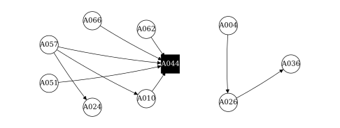

<p align="center">
  
</p>

<h1 align="center">FNSA</h1>
<p align="center">Facebook Network &amp; Social Analysis</p>
<p align="center"><strong>Natan Smogór</strong><br>Academic project report · 13 October 2026</p>

---

FNSA is a reproducible exploratory social network analysis of a public Facebook sample. It connects **collection with Scrapling**, structured record validation, directed graph construction and an English research report. The delivered analysis runs offline.

The research question is deliberately bounded: **what commenting and explicit tagging relationships were observed in WEBC and Expats in Warsaw during 2026?** Results describe the recovered sample rather than the complete communities.

## At a glance

| Frozen sample | Records |
| :--- | ---: |
| Public groups | 7 |
| Posts with exact publication timestamps | 63 |
| Comments | 25 |
| Actor profiles | 73 |
| Explicit tagged mentions | 5 |
| Observed actor-group pairs | 71 |

Collection date: **13 October 2026**. The main study interval is **1 January–13 October 2026**, inclusive in Europe/Warsaw. Publication time and capture time are kept separate. Actor identifiers are read as strings; original names and served text retain their original language.

## Main result

For the two Warsaw groups in the 2026 window, we collected **24 posts, 6 comments and 3 explicit tags**. The graph contains 27 profiles and 9 arrows. Each arrow records a comment-to-post-author link or a tag; it is not a friendship.

The conclusions below apply **only to these collected records**:

- **Most recorded commenting was around one post.** Five of the six comments came from five different profiles on a post by anonymous profile A044. That thread explains why A044 has the most connections in this sample; its real identity is unknown.
- **The connected profiles form two separate sets, of 7 and 3 profiles.** No recorded arrow joins them. They are fragments of observed activity, not proven communities.
- **Most collected profiles have no recorded connection: 17 of 27.** Only 10 have an observed non-loop link. The sample captures many publishing profiles but few visible interactions; this does not establish inactivity elsewhere.
- **Tags contribute three of the nine events.** They add references to other profiles, including profiles with no authored activity in the sample. A reference is not necessarily a conversation or evidence of membership.

<p align="center">
  
</p>

Open circles are served User profiles; solid squares are group-scoped anonymous profiles. Arrows follow the observed relationship convention. Position is a layout choice. A### labels are reversible project pseudonyms, not anonymization.

| Analysis variant | Actors | Active | Isolates | Directed pairs | Non-loop events |
| :--- | ---: | ---: | ---: | ---: | ---: |
| Full sample · all seven groups, all years | 73 | 30 | 43 | 26 | 27 |
| Two community groups · all years | 31 | 14 | 17 | 12 | 13 |
| Two community groups · 2026 | 27 | 10 | 17 | 9 | 9 |

These variants test sensitivity to source and time selection. Their differences are not estimates of population trends.

## Reproduce

Use **Python 3.13**, the tested interpreter. Clone the repository, then run:

```bash
git clone https://github.com/Jaqwilk/FNSA.git
cd FNSA
python3 -m venv .venv
source .venv/bin/activate
python -m pip install -r requirements.txt
python analysis.py
python validate_project.py
python generate_report.py
```

On Windows, activate the environment with `.venv\Scripts\Activate.ps1`. Analysis and PDF generation use only local project inputs; browser installation is unnecessary for this workflow.

Open `analysis.ipynb` in VS Code or Jupyter, select the project environment and run all cells. The delivered notebook includes successful execution outputs. Validation checks source joins, timestamps, graph weights, anonymous identity scope and notebook execution. **29 local checks passed.**

`results/community_2026_interactions.graphml` opens in Gephi or NetworkX. Preserve edge direction and the `weight` attribute when importing.

## Method

1. **Collect.** Use Scrapling to retrieve publicly served pages and page-triggered structured responses; preserve IDs, exact publication times and provenance.
2. **Validate.** Deduplicate entity/event IDs, check joins and keep anonymous profiles scoped to their groups.
3. **Select.** Build the full sample, two-group historical cohort and two-group 2026 cohort. The latter requires both parent posts and event timestamps to lie in the study interval.
4. **Construct.** Comments point from comment author to post author; mentions point from content author to an explicitly tagged actor. Aggregate non-loop events into weighted directed pairs.
5. **Analyze.** Retain isolates and calculate degree, strength, density, components and directed unweighted betweenness. A separate bipartite graph records actor-group publishing/commenting activity.
6. **Report.** Generate tables, GraphML, manuscript figures and a step-by-step PDF from the same frozen inputs.

<p>
  
  <strong>Scrapling</strong> was the scraping framework used for the public collection. Its browser fetching and captured page responses supported the structured extraction scripts included in this repository.
</p>

## Project structure

```text
FNSA/
├── SNA_Project_Step_by_Step.pdf   English academic report
├── analysis.ipynb                Executed walkthrough
├── analysis.py                   Offline network analysis
├── validate_project.py           Data and export validation
├── generate_report.py            Reusable monochrome paper layout
├── report_config.json            Title, author, institution and date
├── collect_data.py               Optional Scrapling recollection
├── data/                         Nine CSV tables and source metadata
├── results/                      Metrics, events, edges and GraphML
├── figures/                      Analysis charts and vector paper figures
├── assets/                       Original logos, vector icons and attribution
├── tools/                        Structured extraction and enrichment
├── DATA_DICTIONARY.md             Table definitions and graph conventions
├── requirements.txt              Pinned direct dependencies
├── CITATION.cff                   Citation metadata
├── NOTICE                        Copyright and third-party notices
└── LICENSE                       Apache License 2.0
```

Raw browser captures, sessions, caches and development environments are excluded. The nine CSV inputs suffice to reproduce the analysis. Original `source_file` values retain provenance from captures stored outside this repository and may not resolve in a standalone clone.

## Optional new collection

The collector revisits known public post permalinks. It saves new captures separately under `collections/` and preserves the frozen `data/` snapshot.

```bash
scrapling install
python collect_data.py --group 20442701688 --limit 5
python collect_data.py --group 20442701688 --limit 5 --run
```

Without `--run`, the collector only prints a plan. Logged-out access can stop at a login wall or access limit; full post/comment coverage is not guaranteed. A new collection requires validation, deduplication and a separate versioned snapshot before analysis.

## Why Facebook collection was difficult

We used Scrapling without logging in. The login prompt returned during scrolling, public previews changed between visits, and comment expansion exposed only part of some threads. More scrolling, installed Chrome and the tested StealthySession did not establish complete history or user lists.

| Data type | What we could verify in our tests |
| :--- | :--- |
| Core metadata | Post, author and group IDs; exact times on tested direct post links; observed posting/commenting participation. |
| Public interactions | IDs, authors and times for visible comments, plus explicit tagged targets. The same selected comments and tags repeated in the fixed-thread tests. Coverage across threads remains incomplete. |
| Optional context | Served text and exposed engagement totals. These can be snippets or changing snapshots. |
| Not established | Complete membership/friendship lists, individual reactor/sharer IDs, reliable usernames and verified nested replies. |

**These are the usable data types verified by our logged-out tests, not a universal list of everything Scrapling or Facebook can provide.** Consistency means repeated extraction from the tested visible records. It does not mean every post or comment is visible, the returned records are always identical, or access will remain stable over time. The collection-reliability note documents the repeated-test evidence.

## Interpretation limits

This sample supports a **minimum exploratory SNA**, with descriptive statistics and reproducible exports. It does not establish complete group membership, friendship, real-world identity, influence or community structure.

Comment coverage is partial and no verified nested replies were collected. Seven actor profiles are group-scoped anonymous identities and three display names are missing. The 133 engagement observations are repeated count snapshots; they cannot be summed into user-level reaction/share edges. Source selection and public visibility are not random.

The next study should predefine comparable groups, a time window and a post-selection rule, record attempted/recovered coverage, and collect more verified comments and replies.

## Report template

The short PDF explains only the essential data, collection steps, network rules, results and reproduction commands in plain English. It uses a minimalist research-paper layout: serif typography, numbered sections, monochrome vector figures, an abstract and a final reference section. Only the original logos use color. All explanations are English.

Edit `report_config.json` to change the title, author, institution or date, then run `python generate_report.py`. University artwork, the original Scrapling logo and Lucide vector icons are stored locally so report generation remains offline.

## License and attribution

Original project code and documentation are released under **Apache License 2.0**. Third-party logos and icons retain their own rights and notices. Collected Facebook text, profile names and source material are observational third-party content; the project license does not grant rights to that content or to trademarks. Attribution is recorded in `NOTICE` and `assets/SOURCES.md`.

## References and project links

- [Step-by-step research report](SNA_Project_Step_by_Step.pdf)
- [Executed notebook](analysis.ipynb)
- [Data dictionary](DATA_DICTIONARY.md)
- [Findings and limitations](results/FINDINGS.md)
- [Collection reliability and tested data types](docs/COLLECTION_RELIABILITY.md)
- [Report clarity audit](docs/REPORT_AUDIT.md)
- [Validation results](results/validation.json)
- [Source groups and sampling configuration](data/sources.json)
- [Visual asset sources](assets/SOURCES.md)
- [Apache License 2.0](LICENSE)
- [Scrapling](https://github.com/D4Vinci/Scrapling) · [Dynamic fetching documentation](https://scrapling.readthedocs.io/en/latest/fetching/dynamic.html)
- [NetworkX documentation](https://networkx.org/documentation/stable/)
- [Kozminski University](https://www.kozminski.edu.pl/en)

README structure follows the clear overview, installation, usage, documentation and license organization used by the Scrapling and NetworkX projects. PDF design references and every collection-source URL are listed at the end of the report.
